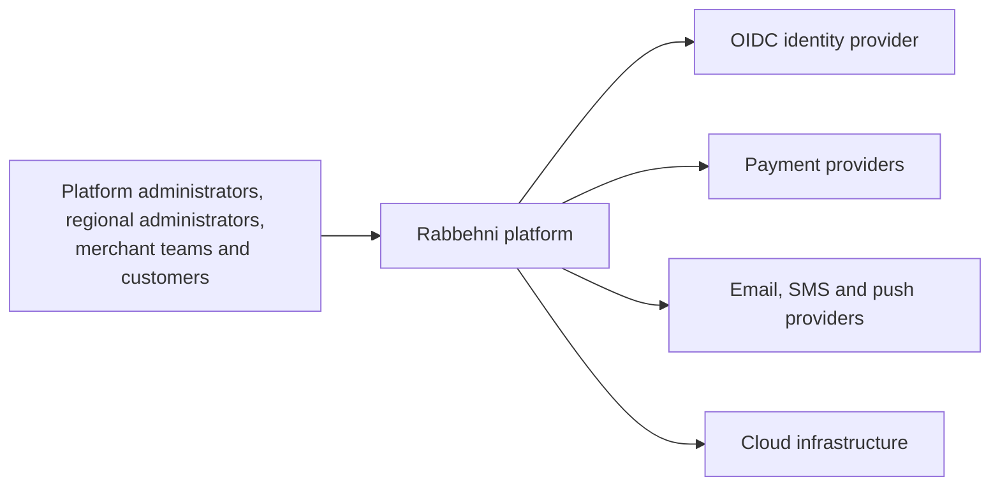
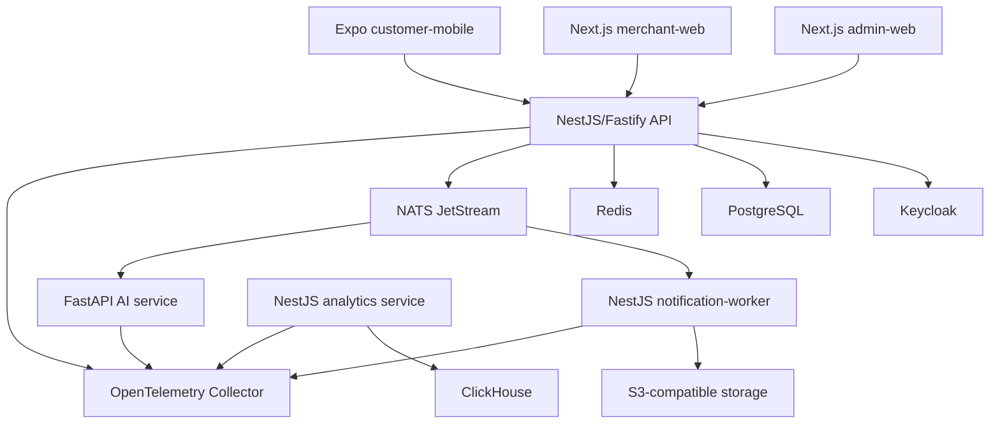

# System context and containers

## Context

External payment and messaging adapters remain architecture placeholders in Phase 1.

## Containers

Solid nodes describe deployable technical boundaries. Phase 1 wires only health dependencies:
API-to-PostgreSQL/Redis/BullMQ, analytics-to-ClickHouse and notification-worker-to-BullMQ.
Event arrows describe the approved later integration style, not an implemented business flow.

## Communication rules

- Client-to-platform traffic uses versioned HTTPS REST APIs.
- Server-to-client live dashboard updates prefer SSE.
- Domain events use NATS JetStream with versioned envelopes.
- Scheduled or retryable tasks use Redis-backed BullMQ queues.
- Object payloads larger than broker limits are stored in S3 and referenced by URI.
- No frontend connects directly to PostgreSQL, Redis, NATS or ClickHouse.
